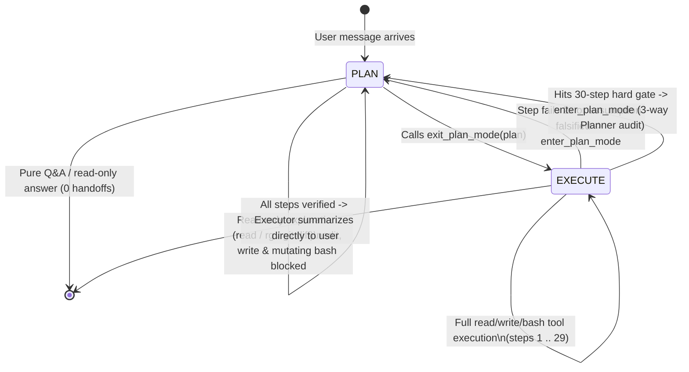

# pi-plan-execute-orchestrator

Single-conversation, two-phase **Plan & Execute Orchestrator** extension for [`@earendil-works/pi-coding-agent`](https://github.com/badlogic/pi-mono).

It brings Antigravity (`agy` 1.5.7 `core/planexecute`)-style **Planner + Executor** model routing to **Pi** (TUI, CLI `--model`, ACP, and [Paseo](https://github.com/getpaseo/paseo)) using any provider/model pair you configure (Anthropic, OpenAI, Magpie, OpenRouter, DeepSeek, GLM, etc.).

---

## Why Single-Conversation Plan & Execute?

Unlike subagent spawners (`create_subagent`) or multi-tab swarms where child agents run in isolated context windows and return a compressed summary, `pi-plan-execute-orchestrator` runs **both models on the exact same conversation transcript** via `pi.registerVirtualModel`:

1. **Zero Handoff Information Loss**: When the Planner calls `exit_plan_mode(plan)`, the Executor inherits the full conversation history and every file the Planner just read. When the Executor hands back via `enter_plan_mode(reason, status_report)`, the Planner inspects the exact tool calls, diffs, and errors the Executor produced.
2. **Hard Read-Only Gate in `plan` Mode**: During the Planning phase, `edit` and `write` tools are blocked, and `bash` commands are inspected to block state-mutating operations (`rm`, `mv`, `git commit`, `npm install`, `sed -i`, shell redirects `>`, etc.) while allowing read-only codebase exploration (`rg`, `git status`, `git diff`, `ls`, `cat`, etc.).
3. **2-Failure Escalation & 30-Step Hard Review Gate**:
   - **Soft Rule**: If a step fails twice in a row or a `"Re-plan if:"` assumption is falsified, the Executor stops and calls `enter_plan_mode`.
   - **Hard Gate**: Every `reviewEvery` (default `30`) Executor invocations since handoff, all tools except `enter_plan_mode` are locked so the Planner can audit whether the Executor drifted, needs a revised plan, or is already done.
4. **Virtual Model Registration**: Every configured preset is registered via `pi.registerVirtualModel` (e.g., `magpie/orchestrator-opus-ds`), so it works out of the box in Pi's `/model` selector, `pi --model`, and external hosts like **Paseo** without needing custom CLI flags.

---

## State Machine Architecture



---

## Installation

### Option 1: Install via `pi install` (Recommended)

```bash
pi install git:github.com/apple-ouyang/pi-plan-execute-orchestrator
```

### Option 2: Local Clone / Symlink

```bash
git clone https://github.com/apple-ouyang/pi-plan-execute-orchestrator.git
mkdir -p ~/.pi/agent/extensions
ln -sf "$(pwd)/pi-plan-execute-orchestrator/extensions/plan-execute-orchestrator.ts" \
  ~/.pi/agent/extensions/plan-execute-orchestrator.ts
ln -sf "$(pwd)/pi-plan-execute-orchestrator/extensions/core.ts" \
  ~/.pi/agent/extensions/core.ts
```

---

## Configuration (`~/.pi/agent/orchestrators.json`)

Run `/orchestrator init` inside Pi, or create `~/.pi/agent/orchestrators.json` (see [`examples/orchestrators.json`](./examples/orchestrators.json)):

```json
{
  "provider": "magpie",
  "reviewEvery": 30,
  "aliases": {
    "opus": "magpie/auto/claude-opus-5-5",
    "sonnet": "magpie/auto/claude-sonnet-5-5",
    "sol": "magpie/codex/gpt-6.1-sol",
    "glm": "magpie/auto/glm-5.3",
    "glm-flash": "magpie/auto/glm-5.3-flash",
    "deepseek": "magpie/auto/deepseek-flash",
    "ds": "magpie/auto/deepseek-flash"
  },
  "presets": [
    {
      "id": "orchestrator-opus-ds",
      "name": "Orchestrator · Opus 5.5 + DeepSeek Flash",
      "planner": "magpie/auto/claude-opus-5-5",
      "executor": "magpie/auto/deepseek-flash"
    },
    {
      "id": "orchestrator-sol-ds",
      "name": "Orchestrator · GPT-6.1 Sol + DeepSeek Flash",
      "planner": "magpie/codex/gpt-6.1-sol",
      "executor": "magpie/auto/deepseek-flash"
    },
    {
      "id": "orchestrator-glm-ds",
      "name": "Orchestrator · GLM-5.3 + DeepSeek Flash",
      "planner": "magpie/auto/glm-5.3",
      "executor": "magpie/auto/deepseek-flash"
    }
  ]
}
```

Verify that Pi registers the virtual models:

```bash
pi --list-models | grep orchestrator
```

Run Pi with a virtual Orchestrator model:

```bash
pi --model magpie/orchestrator-opus-ds -p "Audit the auth middleware and fix the token expiry bug"
```

---

## Interactive `/orchestrator` Commands

Inside Pi TUI, you can inspect or dynamically override the Planner + Executor pair at any time without editing config files:

| Command | Description |
| :--- | :--- |
| `/orchestrator status` | Show current phase (`PLAN` / `EXECUTE`), step count (`steps/30`), active Planner & Executor models, and aliases |
| `/orchestrator pair <planner> <executor>` | Dynamically override the session's Planner & Executor models (supports aliases like `/orchestrator pair opus ds` or full IDs) |
| `/orchestrator reset` | Reset the session pair override back to the virtual model preset defaults |
| `/orchestrator plan` | Manually force the conversation into `PLAN` (read-only) mode |
| `/orchestrator execute` | Manually force the conversation into `EXECUTE` (read-write) mode |
| `/orchestrator init` | Write a starter `~/.pi/agent/orchestrators.json` if one does not exist |

---

## Paseo Integration

To expose your virtual Orchestrator models in [Paseo](https://github.com/getpaseo/paseo)'s model selector under the **Pi** provider, add the preset IDs to `~/.paseo/config.json`:

```json
{
  "agents": {
    "providers": {
      "pi": {
        "models": [
          {
            "id": "magpie/orchestrator-opus-ds",
            "name": "Orchestrator · Opus 5.5 + DeepSeek",
            "thinking": ["low", "high", "max"]
          },
          {
            "id": "magpie/orchestrator-sol-ds",
            "name": "Orchestrator · GPT-6.1 Sol + DeepSeek",
            "thinking": ["low", "high", "max"]
          },
          {
            "id": "magpie/orchestrator-glm-ds",
            "name": "Orchestrator · GLM-5.3 + DeepSeek",
            "thinking": ["low", "high", "max"]
          }
        ]
      }
    }
  }
}
```

Then reload Paseo:

```bash
paseo reload
```

---

## Development & Tests

Run the unit test suite using Node's built-in TypeScript test runner (Node 22.6+ / Node 24+):

```bash
npm test
```

## License

[MIT](./LICENSE)
